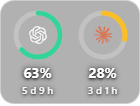

<div align="center">


# Quota Orb

### Weekly Codex and Claude usage at a glance

A small, private, always-on-top desktop widget for Windows 11.

[](https://github.com/yeremyacuna/quota-orb/actions/workflows/validate.yml)
[](https://github.com/yeremyacuna/quota-orb/actions/workflows/codeql.yml)
[](https://github.com/yeremyacuna/quota-orb/releases/latest)
[](LICENSE)

[](https://github.com/yeremyacuna/quota-orb/releases/latest)

</div>

---

## Contents

- [Overview](#overview)
- [Preview](#preview)
- [Install](#install)
- [First use](#first-use)
- [How it works](#how-it-works)
- [Security and privacy](#security-and-privacy)
- [Repository structure](#repository-structure)
- [Owner configuration](#owner-configuration)
- [Development](#development)
- [Distribution](#distribution)
- [License](#license)

---

## Overview

Quota Orb displays the **remaining weekly usage** for Codex and Claude as two progress rings. It stays above other windows, remembers its position, refreshes every minute, and can be shown or hidden from the system tray.

- **Green:** more than 40% remaining.
- **Yellow:** 15–40% remaining.
- **Red:** less than 15% remaining.
- **Full ring:** 100% available.
- **Empty ring:** no remaining quota or no session data.

The widget does not appear on the taskbar. It starts when the user signs in, a left click on the tray icon toggles visibility, and a right click opens the **Quit** command.

---

## Preview

<div align="center">



<sub>This screenshot contains fictitious values and no private account data.</sub>

</div>

---

## Install

1. Open the [latest release](https://github.com/yeremyacuna/quota-orb/releases/latest).
2. Download **`QuotaOrb-Setup-1.0.1-x64.exe`**.
3. Run the installer.
4. Launch **Quota Orb** from the Start menu or desktop shortcut.

End users do not need Git, Node.js, npm, the repository, or its documentation. GitHub's automatically generated `Source code` archives are for developers and do not install the application.

> [!WARNING]
> The current installer is not digitally signed. Windows SmartScreen may display an unknown-publisher warning. Download installers only from this repository's official Releases page.

---

## First use

### Codex

Use Codex normally. Quota Orb reads recent rate-limit events from `~/.codex/sessions` and selects the 10,080-minute weekly window. It reads only the tails of recent session files and does not need an OpenAI API key or an additional network request.

### Claude

The Claude desktop application alone does not create the CLI session required by the widget. Install the official Claude CLI and run once:

```powershell
claude auth login
```

Quota Orb reads credentials only from the official Claude CLI location. It does not search browsers or unrelated files.

Claude access tokens typically expire after about eight hours. Shortly before expiry, Quota Orb asks the official CLI to renew the session with a minimal Haiku request. This can consume a small number of tokens, approximately three times per day while the widget remains open. Set `QUOTA_ORB_NO_REFRESH=1` to disable this behavior.

---

## How it works

```text
Local Codex sessions ──────┐
                           ├── Loopback server ── Electron widget
Anthropic usage endpoint ──┘      127.0.0.1          │
                                                      ├── System tray
                                                      ├── Position memory
                                                      └── Login startup
```

| Source | Method | Refresh behavior |
|---|---|---:|
| Codex | Reads the tails of recent local session files and identifies the weekly window by duration | Every minute |
| Claude | Calls Anthropic's OAuth usage endpoint with the official CLI session | Every minute, with a 3-minute cache |

The local server uses only Node.js's built-in `http` module and listens exclusively on `127.0.0.1`. The renderer never receives account tokens.

Anthropic's OAuth usage endpoint is undocumented and may change. Parsing and compatibility handling are isolated in `src/claude.js`.

See [Architecture](docs/ARCHITECTURE.md) for the complete design.

---

## Security and privacy

- The renderer uses context isolation, Chromium sandboxing, no Node.js integration, and no webviews.
- Browser permissions, navigation, popups, and production DevTools are disabled.
- A restrictive Content Security Policy allows only packaged scripts, styles, images, and same-origin requests.
- The loopback server validates Host and Origin headers and adds defensive browser headers.
- Tokens stay in the main process, are never logged, and are never written by Quota Orb.
- Runtime state is stored in the operating system's user-data directory, outside the installation folder.
- CI runs tests, secret detection, dependency auditing, and CodeQL analysis.
- Dependabot checks npm and GitHub Actions dependencies.

Report vulnerabilities privately according to [SECURITY.md](SECURITY.md). No application can guarantee complete security; users should keep Windows, Quota Orb, Codex, and the Claude CLI updated.

---

## Repository structure

Only the main folders are listed here:

| Folder | Purpose |
|---|---|
| `.github/` | GitHub Actions, release automation, CodeQL, and Dependabot configuration. |
| `assets/` | Application and tray icons packaged with the product. |
| `docs/` | Architecture, configuration, verification results, roadmap, and the public screenshot. |
| `src/` | Electron main process, local server, data readers, preload bridge, and widget UI. |
| `test/` | Unit and security-oriented HTTP tests. It is not included in the installer. |
| `tools/` | Development-only scripts such as icon generation and secret checking. It is not included in the installer. |

---

## Owner configuration

The files most useful to a maintainer are:

| File | Why it matters |
|---|---|
| `package.json` | Defines scripts, Electron versions, installer identity, packaged files, and shortcuts. |
| `package-lock.json` | Pins the complete dependency tree for reproducible builds. |
| `.gitignore` | Excludes credentials, environment files, certificates, runtime state, logs, and build output. |
| `.github/workflows/validate.yml` | Controls tests, secret checking, and dependency auditing on pushes and pull requests. |
| `.github/workflows/release.yml` | Produces and publishes the Windows installer for `v*` tags. |
| `.github/workflows/codeql.yml` | Runs static security analysis. |
| `.github/dependabot.yml` | Schedules dependency update pull requests. |
| `SECURITY.md` | Defines supported versions and private vulnerability reporting. |
| `docs/CONFIGURATION.md` | Documents every supported environment variable. |

Quota Orb does not automatically read `.env` files. `.env` and all `.env.*` variants are ignored, except for a sanitized `.env.example` if one is added later. Never store access tokens in this repository.

---

## Development

Requirements: Node.js 22 or later, npm, and Windows 11 x64 to build the current installer.

```powershell
git clone git@github.com:yeremyacuna/quota-orb.git
cd quota-orb
npm ci
npm test
npm run security:check
npm start
```

Build a local installer with:

```powershell
npm run dist
```

---

## Distribution

`npm run dist` creates a local `dist/` directory. It is ignored by Git and can be deleted and regenerated at any time. GitHub Actions performs a separate clean build and uploads the resulting `.exe` to Releases.

The installer packages only `src/`, `assets/`, and the runtime `package.json` inside `resources/app.asar`, together with the Electron runtime required to execute the application. It excludes the README, documentation, tests, development tools, `.env` files, agent instructions, credentials, and local runtime data.

Electron applications necessarily install supporting executables and libraries in addition to the main `.exe`. The user does not need to manage those files. `app.asar` is packaging, not encryption; application code can be extracted, and this repository already publishes that code.

The current application launches directly as a widget and tray process. A separate settings window is planned so appearance, startup, providers, privacy, and diagnostics can be configured without enlarging the widget. See the [roadmap](docs/ROADMAP.md).

---

## License

Quota Orb is distributed under the [MIT License](LICENSE). MIT permits other people to use, copy, modify, distribute, sublicense, and sell copies while preserving the copyright and license notice. It also disclaims warranties and limits the author's liability to the extent allowed by applicable law.

MIT does **not** prevent copying, does not guarantee immunity from every legal claim, and is not a substitute for legal advice. Preventing reuse would require a different distribution and licensing strategy; rights already granted under a published MIT version cannot generally be withdrawn from existing recipients.

The logos come from [Simple Icons](https://simpleicons.org) under CC0. All trademarks belong to their respective owners. Quota Orb is an independent project and is not affiliated with OpenAI or Anthropic.

<div align="center">

Created by [Yeremy Acuña](https://github.com/yeremyacuna)

**[Download Quota Orb](https://github.com/yeremyacuna/quota-orb/releases/latest)**

</div>
